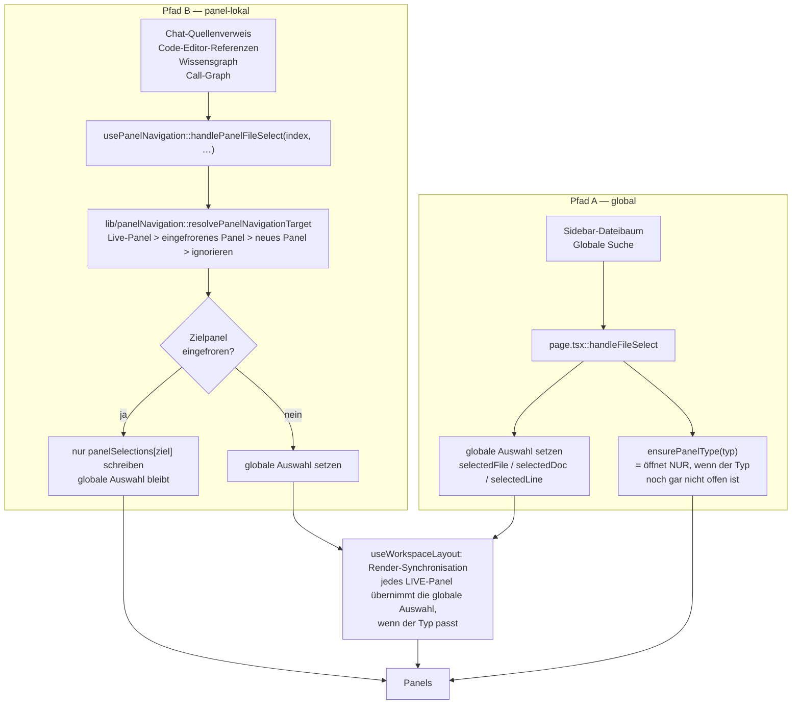

# Doctwos — Panel-Synchronisation (Soll-Matrix)

**Stand:** 29.10.2026 (Abschnitt 7 neu: wer welchen Zustand besitzt, Projektwechsel als ein Übergang, veraltete Antworten; PS-31. Fokus-Debugging: PS-11, PS-12 und PS-24 geändert, PS-32 neu. Davor 06.09.2026: D-1 bis D-4 entschieden, offen ist nur D-5)
**Anlass:** O-092 (abgeschlossen; aktiver Backlog: [TODO.md](TODO.md)) — „Eine Aktion in einer Ansicht wird
nicht in jeder Konstellation korrekt in die anderen Ansichten synchronisiert; das
Verhalten wirkt fallabhängig."

**Zweck:** Festlegen, welches Panel auf welche Aktion reagieren *soll* — bevor das
Verhalten in Tests zementiert wird. Ohne diese Festlegung testet man den
Ist-Zustand statt der Absicht. Jede Zeile der Matrix hat eine ID (`PS-nn`), auf die
sich die Regressionstests in `frontend/hooks/panelSyncMatrix.test.tsx` beziehen.

---

## 1. Die zwei Navigationspfade

Der wichtigste Befund dieser Analyse: es gibt **nicht einen** Navigationsweg, sondern
zwei, mit unterschiedlichen Regeln. Dieselbe Nutzerabsicht („diese Datei öffnen")
läuft je nach Klickort durch den einen oder den anderen — das erklärt den Eindruck,
das Verhalten sei fallabhängig.



Die Synchronisationsregel selbst (`useWorkspaceLayout.ts`, Render-Block
„Synchronize live panels during render") lautet im Ist-Zustand:

> Ein Panel übernimmt die globale Auswahl, wenn es **nicht eingefroren** ist **und**
> (sein Typ `chat`, `graph` oder `callgraph` ist **oder** die Auswahl leer ist
> **oder** der Auswahltyp genau seinem Panel-Typ entspricht).

Daraus folgt unmittelbar: `linkmanager`- und `webview`-Panels stehen außerhalb der
Always-Sync-Liste, eingefrorene Panels immer außerhalb.

---

## 2. Die Dimensionen — und warum der Layoutmodus keine ist

Ursprünglich war die Matrix als **Auslöser-Ansicht × Aktion × Layoutmodus** geplant.
Der Layoutmodus fällt bei der Prüfung als eigene Dimension weg:

```ts
// useWorkspaceLayout.ts:597
layoutMode: panelConfigs.length === 1 ? '1-pane'
          : panelConfigs.length === 2 ? 'split'
          : panelConfigs.length === 3 ? '3-col' : '4-grid'
```

Der Layoutmodus ist **kein Eingabewert, sondern eine Anzeige der Panel-Anzahl**. Er
beeinflusst die Navigation an genau einer Stelle: bei vier Panels greift die Obergrenze
(`addPanel`-Guard und `maxPanels = 4` in `resolvePanelNavigationTarget`), ein fünftes
Panel entsteht nicht. `1-pane`, `split` und `3-col` verhalten sich navigationsseitig
identisch.

Die tatsächlich wirksamen Dimensionen sind deshalb:

| Dimension | Ausprägungen |
|---|---|
| **Pfad** | A (global) · B (panel-lokal), B zusätzlich mit `openIfMissing` und `preserveFrozenTarget` |
| **Aktion** | Code öffnen · Dokument öffnen · Web-Origin öffnen · Objekt fokussieren · Zeile pinnen · Einfrieren/Auftauen · Historie · Panel-Typwechsel |
| **Zielpanel-Zustand** | live vorhanden · nur eingefroren vorhanden · nicht vorhanden (&lt; 4 Panels) · nicht vorhanden (4 Panels = `4-grid`) |

Das reduziert die geplanten 7 × 5 × 4 = 140 Zellen auf die 30 unten, ohne etwas
auszulassen.

---

## 3. Auslöser-Inventar

Welcher Auslöser welchen Pfad mit welchen Parametern benutzt — geprüft am Code:

| Auslöser | Steuerelement | Pfad | Parameter | Fundstelle |
|---|---|---|---|---|
| Sidebar | Dateibaum, Quellenliste | A | — | `app/page.tsx::handleSidebarFileSelect` |
| Globale Suche | Ergebnis „Datei"/„Dokument" | A | — | `app/page.tsx` (Suchergebnis-Handler) |
| Globale Suche | Ergebnis „Objekt" | A | über `handleEntitySelect` | `hooks/usePanelNavigation.ts` |
| Chat | Quellenverweis in der Antwort | B | `openIfMissing=true` | `PanelContentRenderer.tsx` (ChatView-Zweig) |
| Code-Editor | Referenzen-Dropdown, Copybook-Sprung | B | `openIfMissing=true` | `SplitPaneWorkspace.tsx` |
| Code-Editor | Dokument-Treffer im Referenz-Dropdown | B + `onDocFocus` | — | `SplitPaneWorkspace.tsx:1060` |
| Code-Editor | Gutter-Klick / „Objekt fragen" | Chat-Pin | `ensurePanelType('chat')` | `usePanelNavigation::handleGutterClick` |
| Wissensgraph | „In passender Ansicht öffnen" (Objekt) | B | `openIfMissing=true` + `onEntitySelect` | `KnowledgeGraphView.tsx:860` |
| Wissensgraph | „In passender Ansicht öffnen" (Dokument) | B | `openIfMissing=true` + `onDocFocus` | `KnowledgeGraphView.tsx:877` |
| Wissensgraph | Einfachklick auf einen Knoten | B | `openIfMissing=false`, bei Objektknoten mit dem Objekt (`focusedEntity`) | `KnowledgeGraphView.tsx` (`onNodeClick`) |
| Call-Graph | Knoten anklicken | B | `preserveFrozenTarget=true` | `PanelContentRenderer.tsx` (callgraph-Zweig) |
| Link-Manager | — | **keiner** | — | `PanelContentRenderer.tsx` (linkmanager-Zweig) |
| Panel-Kopf | Typ wechseln, Historie, Einfrieren, Schließen | eigene | — | `PanelRenderer.tsx` / `useWorkspaceLayout.ts` |

---

## 4. Die Matrix

**Status-Legende:** ✅ Ist = Soll (durch Test festzuhalten) · ⚠️ Ist ≠ Soll (Fehler,
eigener O-Punkt) · ❓ noch nicht entschieden (siehe Abschnitt 5)

### 4.1 Code-Datei öffnen

| ID | Pfad | Zielpanel-Zustand | Ist-Verhalten | Soll | Status |
|---|---|---|---|---|---|
| PS-01 | A | `code` live vorhanden | Globale Auswahl gesetzt, Live-Panel übernimmt sie beim nächsten Render | wie Ist | ✅ |
| PS-02 | A | kein `code`-Panel, < 4 Panels | `ensurePanelType('code')` öffnet ein Panel; es startet mit der *vorherigen* globalen Auswahl und korrigiert sich im selben Renderdurchlauf über die Sync-Regel | wie Ist (Selbstkorrektur ist Absicht, nicht Zufall — deshalb testen) | ✅ |
| PS-03 | A | nur ein **eingefrorenes** `code`-Panel | Neues Live-Panel; das eingefrorene bleibt unberührt (`ensureLivePanelType`, D-1 umgesetzt 06.09.2026 — vorher galt der Typ als „vorhanden" und es passierte sichtbar nichts) | wie Ist | ✅ |
| PS-04 | A | 4 Panels offen, kein `code` | `ensureLivePanelType` meldet `false` zurück, `page.tsx` zeigt einen Hinweis („Kein Platz für eine weitere Ansicht …"); die globale Auswahl bleibt gesetzt (D-2 umgesetzt 06.09.2026) | wie Ist | ✅ |
| PS-05 | B | Ziel live vorhanden, Auslöser ist ein anderes Panel | Auswahl ins Live-Zielpanel **und** in die globale Auswahl | wie Ist | ✅ |
| PS-06 | B | Ziel = Auslöserpanel selbst, live | Bleibt im eigenen Panel, globale Auswahl folgt | wie Ist | ✅ |
| PS-07 | B | Ziel = Auslöserpanel selbst, **eingefroren** | Schreibt in das eingefrorene Panel, globale Auswahl bleibt unberührt, Panel-Historie wächst | wie Ist: Einfrieren schützt vor *fremder* Navigation, nicht vor Navigation im Panel selbst | ✅ (festgelegt) |
| PS-08 | B | nur ein **eingefrorenes** Zielpanel | Kein Rückfall mehr: neues Live-Panel bzw. Hinweis an der Obergrenze. `resolvePanelNavigationTarget` kennt eingefrorene Panels nicht mehr als Ziel (D-1 umgesetzt 06.09.2026) | wie Ist | ✅ |
| PS-09 | B | dasselbe aus dem Call-Graph | Identisch zu PS-08. Der Sonderparameter `preserveFrozenTarget`, mit dem bisher nur der Call-Graph diesen Schutz hatte, ist mit D-1 entfallen — der Schutz gilt jetzt für alle Auslöser | wie Ist | ✅ |
| PS-10 | B | Ziel fehlt, `openIfMissing=true`, < 4 Panels | Neues Live-Panel mit der Auswahl | wie Ist | ✅ |
| PS-11 | B | Ziel fehlt, `openIfMissing=false` (Graph-Einfachklick) | Kein neues Panel, aber der Fokus wechselt global: Chat-Pin, Wissensgraph, Prozess- und Tropfenansicht folgen. Ein Objektknoten bleibt dabei das Objekt und wird nicht zum Programm seiner Datei aufgelöst. Bis 29.10.2026 passierte nichts, im häufigen Aufbau Chat + Graph erreichte ein Klick also weder Chat noch Prozessansicht | wie Ist | ✅ (geändert 29.10.2026) |
| PS-12 | B | Ziel fehlt, `openIfMissing=true`, 4 Panels | Hinweis-Toast; `resolvePanelNavigationTarget` unterscheidet dafür `ignoreReason: no-space` von `no-matching-panel` (PS-11 bleibt still). Der Fokus wechselt wie in PS-11 und wie bei Pfad A (PS-04) trotzdem | wie Ist | ✅ (geändert 29.10.2026) |

### 4.2 Dokument und Web-Origin öffnen

| ID | Pfad | Konstellation | Ist-Verhalten | Soll | Status |
|---|---|---|---|---|---|
| PS-13 | B | Pfad mit Dokumentendung (`.pdf/.docx/.md/.png/.jpg`) + Quelle | `doc`-Panel | wie Ist | ✅ |
| PS-14 | B | Quelle vom Typ Confluence/Jira | `webview`-Panel, unabhängig von der Endung | wie Ist | ✅ |
| PS-15 | B | Wissensgraph, **Dokument-Knoten mit Code-Endung** (z. B. `.cbl`), Aktion „In passender Ansicht öffnen" | Eine Ansicht: der Zieltyp wird genau einmal bestimmt, hinter `onFileSelect` (`handlePanelFileSelect` → `getSelectionViewType`). Vorher öffnete der zweite, parallele Aufruf `onDocFocus` zusätzlich ein `doc`-Panel und leerte den frisch geöffneten Editor über die globale Doc-Auswahl wieder | Ein Klick = eine Ansicht: Zieltyp genau einmal bestimmen | ✅ (behoben 06.09.2026, [O-091]) |
| PS-16 | B | dieselbe Konstellation, aber Einfachklick (`openIfMissing=false`) | Ein Schreibvorgang; vorher traf der zweite Weg auch hier ein offenes `doc`-Panel | wie PS-15 | ✅ (behoben 06.09.2026, [O-091]) |

### 4.3 Objekt fokussieren

| ID | Auslöser | Ist-Verhalten | Soll | Status |
|---|---|---|---|---|
| PS-17 | Wissensgraph, Objektknoten | `onFileSelect` öffnet/aktualisiert das Code-Panel; `onEntitySelect` schreibt die Entity **panel-lokal in das Graph-Panel** und (nur wenn das Graph-Panel live ist) global. Seit PS-24 ist der Graph im Normalfall live, die Entity also auch global | wie Ist — der Code-Editor löst seine Entity ohnehin selbst über `api.resolveEntity` auf | ✅ |
| PS-18 | Code-Editor, Objekt im Kontextmenü | Panel-lokale Entity, global nur wenn das Panel live ist | wie Ist | ✅ |
| PS-19 | Globale Suche, Objekt-Treffer | `handleEntitySelect`: globale Entity + Referenzen laden + Pfad A | wie Ist | ✅ |

### 4.4 Zeile in den Chat pinnen

| ID | Konstellation | Ist-Verhalten | Soll | Status |
|---|---|---|---|---|
| PS-20 | Gutter-Klick, Chat-Panel offen (live **oder** eingefroren) | `pinnedCode` ist globaler Zustand und erreicht das Chat-Panel unabhängig vom Einfrieren | wie Ist: Einfrieren betrifft die *Auswahl*, nicht den Chat-Pin | ✅ (festgelegt) |
| PS-21 | Gutter-Klick, kein Chat-Panel, 4 Panels offen | Pin wird gesetzt **und** ein Hinweis gezeigt, damit der Nutzer weiß, warum er ihn nirgends sieht | wie Ist | ✅ |

### 4.5 Einfrieren, Historie, Panel-Verwaltung

| ID | Aktion | Ist-Verhalten | Soll | Status |
|---|---|---|---|---|
| PS-22 | Panel einfrieren | Panel behält seine Auswahl und folgt der globalen nicht mehr | wie Ist | ✅ |
| PS-23 | Panel auftauen | Panel übernimmt die globale Auswahl **samt Zeile**. `togglePanelFreeze` setzt `selectedLine` zwar hart auf `null`, die unmittelbar folgende Render-Synchronisation schreibt die globale Zeile aber zurück — das `null` ist redundant, nicht schädlich (beim Schreiben der Tests nachgewiesen; zuerst als Fehler notiert) | wie Ist | ✅ |
| PS-24 | „Wissensgraph öffnen" (Kopfzeile) | Legt das Graph-Panel **live** an, mit dem aktuellen Fokus, genau wie über „Ansicht"; ein vorhandener Graph bleibt, wie er ist. Bis 29.10.2026 wurde er eingefroren angelegt und folgte deshalb, anders als derselbe Graph über „Ansicht", keinem Fokus. Seit der Fokus-Fahrt (Gruppen schrittweise öffnen) ist das Folgen gewollt; wer einen festen Graphen will, friert ihn ein | wie Ist | ✅ (geändert 29.10.2026) |
| PS-25 | Historie zurück/vor (Alt+←/→) in einem **Live**-Panel | Setzt die Panel-Auswahl **und** die globale Auswahl → alle anderen **Live**-Panels ziehen nach, eingefrorene bleiben stehen | wie Ist (D-4 entschieden 06.09.2026) | ✅ |
| PS-26 | Historie in einem **eingefrorenen** Panel | Bleibt lokal | wie Ist | ✅ |
| PS-27 | Panel-Typ im Kopf wechseln | Auswahl des Panels bleibt, Fokus-Objekt und Panel-Historie werden geleert; ein Live-Panel zieht sich anschließend über die Sync-Regel die passende globale Auswahl | wie Ist | ✅ |
| PS-28 | Panel schließen | Slot samt Auswahl/Historie entfernt, globale Auswahl bleibt bestehen | wie Ist | ✅ |

### 4.6 Die Sync-Regel selbst

| ID | Konstellation | Ist-Verhalten | Soll | Status |
|---|---|---|---|---|
| PS-29 | Im Chat ein Dokument öffnen, während ein `callgraph`-Panel offen ist | Der Call-Graph behält seinen Objektfokus: eine eingehende Auswahl ohne Entity wird für `callgraph`-Panels übersprungen (D-3 umgesetzt 06.09.2026) | wie Ist | ✅ |
| PS-30 | `linkmanager`-Panel offen, Navigation an anderer Stelle | Synchronisiert nie (weder ein- noch ausgehend); der Link-Manager ist eine Insel | vorerst wie Ist | ❓ [D-5] |

---

## 5. Offene Festlegungen

Diese Zellen sind fachliche Entscheidungen, keine Fehler im engeren Sinn. Sie müssen
entschieden sein, bevor die betroffenen Zeilen automatisiert werden — sonst zementieren
die Tests einen Zustand, den niemand beschlossen hat.

**D-1 bis D-4 sind am 06.09.2026 entschieden** (D-1 bis D-3 mit Codeänderung, D-4
bestätigt den Ist-Zustand); offen ist nur noch D-5.

| ID | Frage | Betrifft | Vorschlag |
|---|---|---|---|
| **D-1** ✅ | Was gilt, wenn das einzige Panel des Zieltyps eingefroren ist? (Vorher widersprüchlich: Pfad A tat **nichts**, Pfad B **überschrieb** das eingefrorene Panel.) | PS-03, PS-08, PS-09 | **Entschieden 06.09.2026: Einfrieren schützt in beiden Pfaden.** Zielauflösung: Live-Panel → sonst neues Panel → sonst Hinweis. Ein eingefrorenes Panel ändert nur ein Klick **in ihm selbst** (PS-07). Umgesetzt in `lib/panelNavigation.ts` und `useWorkspaceLayout::ensureLivePanelType`. |
| **D-2** ✅ | Was passiert, wenn kein passendes Panel offen ist und die 4-Panel-Grenze erreicht ist? (Vorher: stiller Abbruch in allen drei Varianten.) | PS-04, PS-12, PS-21 | **Entschieden 06.09.2026: kurzer Hinweis** (`page.toast.noPanelSpace`), kein automatisches Umwidmen eines fremden Panels. `addPanel`/`ensurePanelType`/`ensureLivePanelType` melden den Fehlschlag als Rückgabewert. |
| **D-3** ✅ | Soll ein `callgraph`-Panel seinen Fokus verlieren, wenn anderswo ein Dokument geöffnet wird? | PS-29 | **Entschieden 06.09.2026: nein** — Fokus behalten, wenn die eingehende Auswahl keine Entity enthält. Umgesetzt in der Sync-Regel in `useWorkspaceLayout`. |
| **D-4** ✅ | Soll die Historie eines Live-Panels die anderen Live-Panels mitziehen? | PS-25, PS-26 | **Entschieden 06.09.2026: ja, alle Live-Panels ziehen mit, eingefrorene nicht.** „Zurück" ist eine Bewegung der Arbeitssituation, nicht eines einzelnen Fensters; das Einfrieren ist der Ausstieg aus dieser Bewegung. Entspricht dem Ist-Zustand, ist jetzt als PS-25 getestet. |
| **D-5** ❓ | Bleibt der Link-Manager eine Insel? | PS-30 | **Empfehlung nach näherer Prüfung am 06.09.2026: nein.** Wer eine Verknüpfung beurteilen soll, muss beide Seiten sehen können — genau das geht dort nicht. Als eigener Punkt [O-114] erfasst (samt der Nebenbefunde [O-115] toter `link_chat.py`-Endpunkt und [O-116] Umgehung der zentralen API-Schicht), nicht als Teil dieser Aufräumarbeit. |

---

## 6. Stand der Automatisierung

`frontend/hooks/panelSyncMatrix.test.tsx` (34 Fälle; PS-31 und PS-32 seit 29.10.2026) hält die Matrix fest, PS-24 prüft `app/page.test.tsx`:

- **Alle 30 Zeilen** sind als Test abgesichert — Pfad A gegen `useWorkspaceLayout`
  (dessen Sync-Regel war bis dahin gar nicht getestet), Pfad B gegen
  `usePanelNavigation`.
- **PS-15/PS-16** waren die letzten roten Zellen und sind seit dem 06.09.2026
  behoben ([O-091]). PS-15 stand vorher bewusst als `it.fails` drin und ist jetzt
  ein normales `it`; PS-16 ist neu dazugekommen. Die Matrixtests prüfen die
  Zielauflösung; dass der Graph pro Klick nur **einen** Navigationsaufruf abgibt,
  prüft `frontend/components/KnowledgeGraphView.test.tsx` — dort auch strukturell,
  damit kein zweiter Navigationsweg unbemerkt zurückkommt.
- **Kein `it.todo`** mehr offen: D-4 ist entschieden und als PS-25 ausformuliert. Für
  D-5 (Link-Manager) gibt es nichts zu testen, solange er bewusst keine Navigation hat.

Zwei Korrekturen an der Matrix stammen aus dem Schreiben der Tests selbst:

- PS-23 („Auftauen verliert die Zeile") ist **kein** Fehler — die
  Render-Synchronisation holt die Zeile unmittelbar zurück. Die zugehörige
  Entscheidung ist entfallen.
- PS-02 (ein frisch geöffnetes Panel startet mit der *vorherigen* Auswahl und
  korrigiert sich erst über die Sync-Regel) war nirgends festgehalten und ist jetzt
  eigens getestet — sonst sieht die nächste Änderung an `addPanel` wie ein
  harmloser Aufräumschritt aus.

---

## 7. Zustandsbesitz und Übergänge

Die Matrix regelt, welches Panel einer Auswahl folgt. Dieser Abschnitt regelt, **wer** den
verbindlichen Zustand besitzt und wie zusammengehörige Änderungen gemeinsam ablaufen. Anlass:
Architektur-Review (Punkt 6, 29.10.2026).

### 7.1 Wer besitzt welchen Zustand

| Zustand | Besitzer (einzige Quelle) | Andere lesen ihn über |
|---|---|---|
| Gewähltes Projekt, Dateiliste, Entities | `hooks/useProjects.ts` | Props aus `page.tsx` |
| Quellen, Referenzen der geöffneten Datei | `hooks/useKnowledgeSources.ts` | Props |
| Chat-Sitzung, Nachrichten, laufender Stream | `hooks/useChatSessions.ts` (Zustand), `hooks/useChatController.ts` (Ablauf, Stream) | Props; `invalidateChat()` zum Beenden |
| Globale Auswahl, Panel-Auswahl, Objektfokus, Historie, Chat-Pin, Dateiinhalt | `hooks/useWorkspaceLayout.ts` | Props; Sync-Regel aus Abschnitt 4 |
| Auswahl, Fokus, aufgeklappte Gruppen im Wissensgraphen | `components/KnowledgeGraphView.tsx` | lokal; folgt der Panel-Auswahl (Fokus-Fahrt: in der gruppierten Übersicht Gruppen bis zum Ziel öffnen, in „Nur Nachbarschaft“ zur Nachbarschaft des Ziels wechseln; ist das Ziel schon zu sehen, nur hinfahren) |
| Übergänge über mehrere Besitzer | `hooks/useProjectTransition.ts` (Projektwechsel), `page.tsx` (neuer Chat) | — |

Kein Besitzer schreibt in den Zustand eines anderen; ein Übergang ruft die Funktionen der Besitzer
in fester Reihenfolge auf.

### 7.2 Projektwechsel (`useProjectTransition`)

Alle Auslöser gehen durch denselben Übergang; sie unterscheiden sich nur darin, was mit dem Chat
geschieht:

| Auslöser | Chat |
|---|---|
| Kopfzeile, Seitenleiste | neuer Chat, Ansichten schließen (`new`) |
| Suche, Graph-Fokus | neuer Chat nur, wenn die aktive Sitzung zu einem anderen Projekt gehört (`reset-if-foreign`) |
| Sitzung laden | Chat bleibt, die Sitzung bringt ihr Projekt mit (`keep`) |

Reihenfolge: gleiches Projekt → nichts; noch in Analyse → Hinweis, nichts ändern. Sonst Chat
behandeln (ein neuer Chat beendet den laufenden Stream), laufende projektbezogene Anfragen entwerten
(Dateiinhalt, Referenzen), alles leeren, was am alten Projekt hängt (`useWorkspaceLayout.clearSelection`:
Auswahl aller Panels, Objektfokus, Historie, Chat-Pin, Dateiinhalt; die Panels bleiben offen), dann
das neue Projekt setzen und laden. Vorher leerte nur der Weg über die Kopfzeile die Auswahl; über
Suche oder Sitzung blieben Auswahl und Pin des alten Projekts stehen.

### 7.3 Veraltete Antworten

Regel: **Eine Antwort, die zu einem überholten Stand gehört, wird verworfen.** Baustein ist
`lib/requestGate.ts` („neueste Anfrage gewinnt“, plus `invalidate()` für Übergänge). Er sitzt an
jeder Stelle, die nach einem Wechsel eine späte Antwort übernehmen könnte:

| Stelle | Was vorher passieren konnte | Test |
|---|---|---|
| Chat-Stream (`useChatController.runChatStream`) | Antwort eines alten Chats lief nach einem neuen Chat/Projektwechsel weiter und schrieb an derselben Position in die neue Antwort; `isLoading` wurde vom alten Stream beendet. Jetzt: Generation je Stream, Abbruch per `AbortController`, keine Fehlermeldung beim Abbruch | `useChatController.test.tsx` |
| Sitzung laden (`handleSessionSelect`) | Bei schnellem Wechsel A → B zeigten sich A's Nachrichten unter B | `useChatController.test.tsx` |
| Dateiliste, Entities (`useProjects`) | Bei A → B → C landete B's Antwort nach C | `useProjects.test.tsx` |
| Referenzen (`useKnowledgeSources`) | Referenzen einer zuvor geöffneten Datei überschrieben die aktuelle | `useKnowledgeSources.test.tsx` |
| Dateiinhalt (`page.tsx::handleFileSelect`) | Der Editor zeigte den Inhalt einer zuvor geöffneten Datei unter dem neuen Namen | — (siehe unten) |
| Wissensgraph (Übersicht, Nachbarschaft) | Der Graph des vorigen Projekts ersetzte den des neuen | `KnowledgeGraphView.test.tsx` |
| Inhalt im Code-/Dokument-Panel (`SplitPaneWorkspace`, Lade-Effekt) | Bei schnellem Fokuswechsel überschrieb der Inhalt der vorigen Datei den der neuen | — (Abbruch im Effekt-Cleanup) |

Die Tests für Chat, Sitzung, Projekte und Referenzen scheitern am Stand vor dieser Änderung und belegen
damit die Fehler. Der Dateiinhalt hat noch keinen eigenen Test, weil `handleFileSelect` in `page.tsx`
liegt; er nutzt denselben, gesondert getesteten Baustein.

| ID | Auslöser | Soll | Status |
|---|---|---|---|
| PS-31 | Projektwechsel | Auswahl, Objektfokus, Historie und Chat-Pin aller Panels sind leer; die Panels bleiben offen | ✅ |
| PS-32 | Panel mit eigenem Ziel geöffnet (Chat-Verweis, „In passender Ansicht öffnen", Dokument-Sprung, Prozessfluss, Agent) | Das Panel zeigt sein Ziel und folgt danach, sobald sich die globale Auswahl ändert, wie jedes Live-Panel. Bis 29.10.2026 blieb es dauerhaft stehen, wirkte also eingefroren, ohne so angezeigt zu werden | ✅ |

---

## 8. Verweise

- [Priorisierte TODO-Liste](TODO.md) — aktiver Backlog; O-091/O-092 sind abgeschlossen
- `frontend/hooks/panelSyncMatrix.test.tsx` — Regressionstests, nach `PS-nn` benannt
- `frontend/lib/panelNavigation.ts` — Zielauflösung des Pfads B
- `frontend/hooks/useWorkspaceLayout.ts` — Sync-Regel, Einfrieren, Panel-Historie
- `frontend/hooks/usePanelNavigation.ts` — Pfad B
- `frontend/hooks/useProjectTransition.ts` — Projektwechsel als ein Übergang (Abschnitt 7.2)
- `frontend/lib/requestGate.ts` — veraltete Antworten verwerfen (Abschnitt 7.3)
